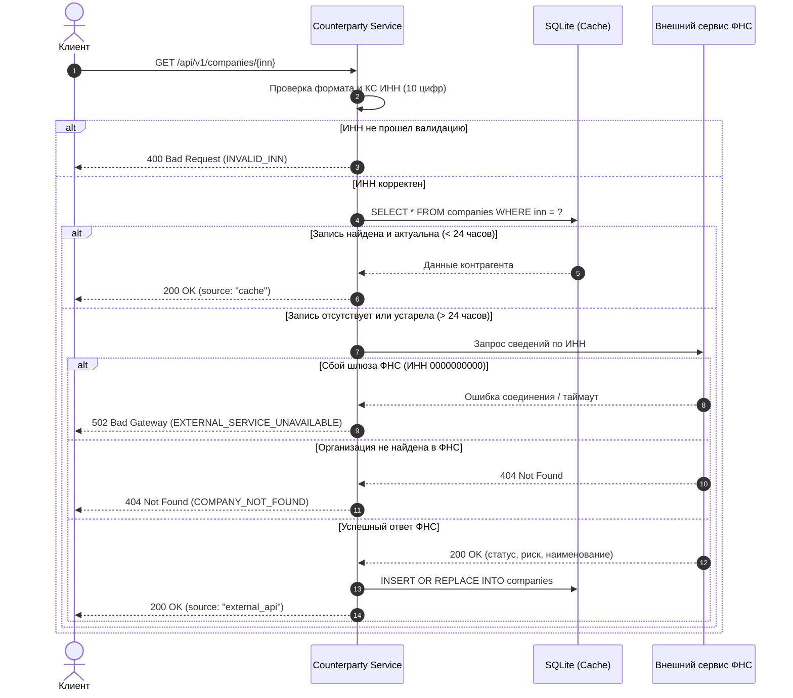

# Counterparty Check Service

REST API сервис проверки статуса и уровня риска контрагентов по 10-значному ИНН с кэшированием результатов внешних запросов в локальной СУБД SQLite.

Стек: Python 3.11+, FastAPI, SQLite (стандартная библиотека `sqlite3`), Pydantic v2.

---

## Бизнес-задача кэширования

При интеграции с внешними государственными и коммерческими реестрами (ФНС, ЕГРЮЛ, СПАРК) возникают следующие системные ограничения:
1. **Тарификация запросов**: большинство коммерческих API взимают плату за каждый входящий вызов. Кэширование повторных запросов существенно сокращает бюджет интеграции.
2. **Лимиты частоты вызовов (Rate Limiting)**: государственные реестры устанавливают жесткие квоты (RPS). При пакетной проверке контрагентов превышение квот приводит к блокировке клиента.
3. **Задержка ответа (Latency)**: время отклика внешнего реестра составляет от 300 до 1500 мс. Ответ из локального SQLite-кэша отдается быстрее 5 мс.
4. **Отказоустойчивость**: при плановых или аварийных регламентных работах на стороне ФНС сервис продолжает обслуживать клиентов на основе данных, полученных в пределах окна актуальности (24 часа).

---

## Sequence-диаграмма взаимодействия



---

## Коды ответов API

| HTTP-код | Статус | Описание |
|---|---|---|
| `200` | `OK` | Контрагент успешно проверен. В теле ответа указан источник (`cache` или `external_api`). |
| `400` | `Bad Request` | Длина ИНН отличается от 10 цифр либо не сошлась контрольная сумма ФНС (`INVALID_INN`). |
| `404` | `Not Found` | Организация с переданным ИНН отсутствует в реестре (`COMPANY_NOT_FOUND`). |
| `502` | `Bad Gateway` | Внешний шлюз реестра недоступен либо превышен таймаут (`EXTERNAL_SERVICE_UNAVAILABLE`). |

---

## Запуск в 3 команды

```bash
# 1. Создать и активировать виртуальное окружение
python3 -m venv .venv && source .venv/bin/activate

# 2. Установить зависимости
pip install -r requirements.txt

# 3. Запустить сервис
uvicorn main:app --reload
```

Интерфейс Swagger UI доступен по адресу: `http://127.0.0.1:8000/docs`

---

## Тестовые данные для проверки в Swagger (`/docs`)

| ИНН | Организация | Ожидаемый результат | Пояснение |
|---|---|---|---|
| `7707083893` | ПАО Сбербанк | `200 OK` (ACTIVE / LOW) | Первый вызов возвращает `source: "external_api"`, второй — `source: "cache"`. |
| `7736207543` | ООО Яндекс | `200 OK` (ACTIVE / LOW) | Проверка действующего контрагента. |
| `7701107869` | ООО Траст-Инвест | `200 OK` (LIQUIDATED / MEDIUM) | Контрагент в стадии ликвидации. |
| `7710140679` | ЗАО СтройКомплекс | `200 OK` (BANKRUPT / HIGH) | Высокий уровень риска (банкротство). |
| `7707083894` | — | `400 Bad Request` | Неверная контрольная цифра (последняя должна быть 3). |
| `0000000000` | — | `502 Bad Gateway` | Специальный тестовый ИНН для имитации аварии внешнего сервиса. |

---

## Запуск тестов

```bash
pytest -v
```
